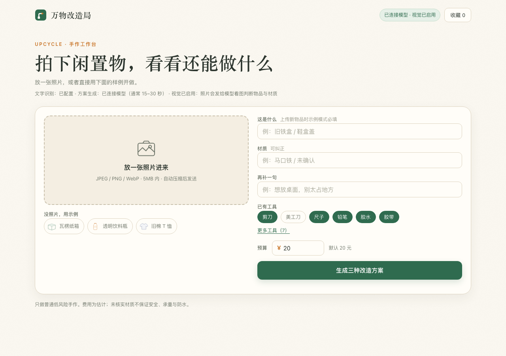

# 万物改造局 · 使用说明书（含线上实测报告）

> 拍一张闲置物的照片，得到**实用款 / 好看款 / 脑洞款**三种能动手做出来的改造方案，并导出制作清单与分享卡。
> **在线地址**：https://case.evansong.cn/upcycle/
> **实测日期**：2026-11-07（线上真实环境，非演示、非模拟数据）

## 0. 这份文档怎么来的

它不是照着界面猜出来的功能介绍，而是**在线上真实环境跑出来的使用记录**：服务端连着真实模型 `qwen3.8-flash`（视觉已开启）与腾讯云文字识别，本报告里的耗时、识别结果、方案标题、OCR 文字行全部来自真实接口响应。文中用到的两张测试照片都是真实物品照片，仅用于验证，不随产品发布。

## 1. 它是什么，不是什么

| 它能做 | 它不做 |
| --- | --- |
| 看照片判断**物品与材质**（模型视觉） | 不判断物品的品牌价值、真伪、成色 |
| 读照片上**真实印着的文字**（OCR） | 不把包装文字当作「看懂了物品」 |
| 一次给三种取向的改造方案 | 不保证每次方案相同，模型有随机性 |
| 按**已有工具 / 预算 / 禁用项**重新校验方案 | 不替你采购、不核实市价 |
| 给出可勾选步骤、材料、估计费用、注意点、结构示意图 | 不出工程图纸，不保证承重、防水、食品安全 |
| 导出 Markdown 制作清单、生成 PNG 分享卡 | 不上传你的原图到服务器长期保存 |

## 2. 开始之前，三件必须知道的事

1. **隐私**：照片会在浏览器里压缩后发给第三方模型服务看图判断物品与材质，文字识别也走云端服务。**不要拍含证件、地址、账单、人脸或敏感信息的照片**。页面顶部的能力状态行会明示「照片会发给模型看图判断物品与材质」。
2. **原图不上传**：浏览器先自动压缩（等比缩小 + 降 JPEG 质量），压缩后的图才发送；预览区会显示压缩后的尺寸与体积。代价是包装上的小字可能变糊。
3. **要等 15–30 秒**：真实模型生成三方案实测约 15–30 秒，按钮会按秒显示已等待时间，请不要反复点击。超时会明确提示并保留已填内容。

*图：线上首页实拍截图。右上角徽标「已连接模型 · 视觉已启用」，标题下的能力状态行写明文字识别、方案生成与等待时长。*

## 3. 一步一步用

### 第 1 步｜打开页面，先看状态
打开上面的地址，看标题下的**能力状态行**：「文字识别：已配置」「方案生成：已连接模型（通常 15–30 秒）」「视觉已启用」。如果这里显示的是「示例方案」，说明当前是未接模型的示例模式，页面会如实标注，不会把示例写成模型生成。

### 第 2 步｜给一张照片，或选内置示例
- **上传**：点左侧虚线框「放一张照片进来」，支持 JPEG / PNG / WebP，5MB 以内、单边不超过 4096 像素。上传后自动压缩并显示结果尺寸。
- **没照片**：点下方三个内置示例（瓦楞纸箱 / 透明饮料瓶 / 旧棉 T 恤），可以直接体验全流程。
- 右侧「这是什么」在**示例模式下上传新图片时必填**；在线模型模式下可以留空，交给视觉识别。

### 第 3 步｜（可选）点「识别文字」
这是**真实 OCR**，只读包装或标签上印着的字。结果会列出每一行文字、置信度，以及一段可复制的文字线索，并明确提示「这只是包装内容，不代表对物品的判断」。识别到的小字可能有误读，请核对后再用。

### 第 4 步｜核对物品与材质
生成方案后，模型会看图给出「这是什么 / 材质」，界面上标注为**（识别结果）**；OCR 文字标注为**（照片文字线索）**。两者来源不同，别混。识别不准时，结果页有可展开的纠正表单，直接改。

### 第 5 步｜设限制
- **已有工具**：常用直达（剪刀、美工刀、尺子、铅笔、胶水、胶带）+「更多工具」里另有 7 项（针线、打孔器、颜料/笔刷、麻绳、热熔胶枪、电钻、锯子）。方案会按你有的工具重新校验，用不到的工具不会硬塞。
- **预算**：默认 20 元，可改。
- **一句描述 / 补充要求 / 禁用项**：例如「想放桌面，别太占地方」「不要用热熔胶」。文本有长度上限（描述 200 字、补充 300 字）。

### 第 6 步｜点「生成三种改造方案」
等待期间按钮按秒计时，超时会提示并保留输入。服务端会再次按预算与工具校验模型输出，不合格的款式会如实标成「不可行」并说明原因，不会假装三款都可行。

### 第 7 步｜读结果页
三张卡片分别是**实用款**（先好用）、**好看款**（摆着顺眼）、**脑洞款**（不实用也没关系）。每张卡有方案名、一句话说明、结构示意 SVG、可行/不可行状态。模式说明只在结果页出现一次。

### 第 8 步｜进制作视图
点任一方案进入制作视图：原物照片与结构示意并排、材料与估计费用、所需工具、注意点、**可勾选的步骤清单**（每步带工具与预计分钟数）。
- **追加限制**：改工具、预算或补充要求，只对当前方案重做一次（`refine`）。
- **导出制作清单**：下载 Markdown 文件，尺寸标注与详情图、分享卡读同一组数值，不会出现宽/深/高互相打架。
- **分享卡**：生成 PNG，直接复用详情里的结构 SVG。
- 右上角**收藏**存浏览器本地，刷新后仍在。

## 4. 三个「来源」不要搞混

| 来源 | 页面标注 | 负责什么 | 能不能改 |
| --- | --- | --- | --- |
| 文字识别 `source=ocr` | （照片文字线索） | 读包装/标签上真实印着的字，给置信度 | 结果可复制核对，不自动等于物品 |
| 视觉识图 `source=vision` | （识别结果） | 模型看图判断「物品 / 材质」 | 结果页可展开表单纠正 |
| 方案生成 `source=llm` | 已连接模型 | 按输入与限制生成三款方案 | 可追加限制重做单款 |

示例模式会用内置规则数据并明确标「示例方案」；**本地模拟上游不是真实大模型**，线上当前是 `mode=live`。

## 5. 线上实测报告（2026-11-07）

### 5.1 测试环境
线上 `GET /api/config`：`mode=live`、`model=qwen3.8-flash`、`vision=true`、`ocr.configured=true`、服务端超时 45 秒。图片约束 5MB / 4096 像素；HTTP 网关请求体实测约 100 KiB，因此前端把 data URL 压到 ≤85,000 字符再发送。

### 5.2 样本 A：透明喷雾瓶（此前实测，作对照）
真实物品照片走完整链路：`visionUsed=true`、`recognized={item:"喷雾瓶", material:"塑料", source:"vision"}`、约 17.3 秒出齐三款方案。结论：模型能正确识别物品类别与材质，不依赖 OCR 文字。

### 5.3 样本 B：带印刷标签的洗发水瓶（本次新增）
测试图是一张真实洗发水瓶照片（Wikimedia Commons，仅用于验证），瓶身印有 `NEW PACK / Dove / NUTRI SERUM / INTENSE REPAIR / NOURISHING SHAMPOO / For Damaged Hair / 80 ml` 等字样。

**① 前端压缩（用与网页完全相同的 Canvas 算法在真实浏览器里跑）**

| 项 | 值 |
| --- | --- |
| 原图 | 960 × 1440，109,585 字节 |
| 压缩后 | 683 × 1024，JPEG 质量 0.82 |
| data URL 长度 | 59,687 字符（上限 85,000） |

**② 真实 OCR**（`POST /api/ocr`，HTTP 200，1.5 秒，`source=ocr`）
读到 10 行、置信度均为 100：`NEW PACK` / `Dove` / `UTR` / `INTENSE` / `REPAIR` / `NOURISHING` / `SHAMPOO` / `For Damaged Hair` / `69715626` / `80ml`。
其中 `UTR` 是瓶身 `NUTRI` 的**误读/截断**——这正说明「识别结果请核对后再用」不是客套话。压缩到 683×1024 后 `80ml` 这类小字仍被读到。

**③ 真实视觉 + 方案生成**（`POST /api/ideas`，不预填物品/材质，预算 30 元、5 件常用工具）
HTTP 200，**17.2 秒**，`mode=live`、`source=llm`、`visionUsed=true`，识别为 **「多芬洗发水瓶 / 塑料」**，三款全部可行、0 个不可行：

| 款式 | 方案 | 步骤（节选） | 注意点 |
| --- | --- | --- | --- |
| 实用款 | 桌面收纳笔筒 | 裁剪瓶身 5 分钟 → 打磨边缘 3 分钟 → 外观美化 1 分钟 | 切口用胶带缠一圈防割手；别盛热水或尖锐物 |
| 好看款 | 迷你多肉花盆 | 剪去上半部分、留底部约 8cm → 铺小石子 → 填土种植 | 不适合长期户外；建议喜阴小型绿植 |
| 脑洞款 | 抽象艺术雕塑 | 挤压瓶身制造褶皱 10 分钟 → 弹性卡扣拼接 20 分钟 → 静置回弹 30 分钟 | 仅供观赏、不可承重；注意别划伤手 |

每款都带 `summary`、分步清单（工具 / 分钟 / 注意）、估计费用、预计总时长、难度、材料、注意点与结构示意图。预算 30 元与 5 件工具在响应里原样回显，约束确实生效。

**④ 对照实验：把 OCR 文字线索一起交给模型**
再发一次同样的图，但带上 OCR 的 10 行文字：HTTP 200、**28.4 秒**，识别结果变成英文 `Dove Intense Repair Shampoo Bottle / Plastic`，三款方案也全换了（简易收纳盒 / 艺术花瓶 / 迷你温室），仍 0 个不可行。
**结论：OCR 文字线索会明显影响模型的命名语言与方案内容，耗时也更长**。这是真实模型的行为，不是 bug；若不希望包装文字带偏方案，可以只用照片、不点「识别文字」。

### 5.4 什么稳定、什么会变

| 稳定（可依赖） | 会变（需人工判断） |
| --- | --- |
| 两张不同照片都正确识别物品与材质 | 每次生成的具体创意不同，不保证复现同一方案 |
| 三款式结构齐全、约束回显一致 | 命名语言可能随 OCR 线索变成英文 |
| OCR 能读出主要标签词与小字 | 小字可能误读（本次 `NUTRI` → `UTR`） |
| 失败会明确报错、保留输入，不静默降级 | 耗时在 15–30 秒区间波动（本次 17.2s / 28.4s） |

## 6. 限制与风险（请逐条看）

- **照片会离开浏览器**：发给第三方模型服务看图、云端文字识别；原图不上传，但压缩图仍包含画面内容。
- **压缩换体积**：网关约 100 KiB 的 body 上限决定了必须压图，小字识别率会下降；拿不准时手动填「这是什么」。
- **识别不是鉴定**：视觉判断的是物品类别与材质，未核实的材质不保证安全、承重、防水或食品接触安全；涉及刀具、热熔胶、电钻的方案请自行评估。
- **费用是估计值**，不是报价；结构示意图只表示尺寸与折叠/连接关系，不是成品图。
- **只做低风险手作**：不要把这个工具用于改造承压、通电、盛装食品或儿童用品等关键场景。
- **公开网址有轻量护栏**：同一来源 60 秒内 `ideas/refine` 各 12 次、`ocr` 24 次，超限返回 429 并提示等一分钟；这是单容器计数，不是强防刷。
- **证书与域名**：当前可分享地址无测试域名风险提醒；默认域名仍在切换计划中，地址可能变化。

## 7. 常见问题与排错

| 现象 | 原因 / 怎么办 |
| --- | --- |
| 一直转圈 | 真实模型要 15–30 秒，按钮按秒计时；超时会明确提示并保留输入，别重复点 |
| 提示照片太大 / 413 | 网关约 100 KiB 限制；前端已自动压缩，仍失败就换更小或更简单的照片 |
| 点「识别文字」没读到字 | 包装上没字，或字被压缩糊掉；可直接手动填「这是什么」，视觉识别不受影响 |
| 文字识别报错 | 临时凭据或权限失效、图片异常、上游超时；页面返回明确错误码，不会假装识别成功，稍后重试 |
| 429 `rate_limited` | 一分钟内请求太多，等一分钟再试 |
| 某款标「不可行」 | 预算/工具/禁用项与方案冲突，约束校验生效而不是故障；放宽限制或点「追加限制」重做 |
| 识别成英文或识别错了 | OCR 文字线索会影响模型；结果页展开纠正表单改物品/材质，再重做 |
| 清单/分享卡没下载 | 检查浏览器是否拦截下载或弹窗；分享卡用页面内 Canvas 生成 |
| 收藏不见了 | 收藏存在浏览器 localStorage，换设备、清缓存或无痕模式会丢 |
| 出现「风险提醒」中间页 | 用的是测试域名才会有；改用本文档开头的自定义域名地址 |

## 8. 进阶：接口与本地运行

| 方法 | 路径 | 说明 |
| --- | --- | --- |
| GET | `/api/config` | 公共配置、工具表、示例表、能力状态（不含密钥） |
| POST | `/api/ideas` | 生成三方案；可带 `image` / `ocrText` / `item` / `material` / `description` / `tools` / `budget` / `forbidden` / `extra` |
| POST | `/api/refine` | 按新限制重做单个方案 |
| POST | `/api/ocr` | 真实文字识别 |
| GET | `/api/diag` | 云函数只读能力自检（结果同容器缓存 60 秒） |

本地跑：`cd app && npm start`，打开 `http://127.0.0.1:4173/`。不配置环境变量时自动进入**示例模式**（内置规则、明确标注「示例方案」），不会假装调用模型。跑完整回归用 `npm run verify:all`（含线上检查，需要部署后运行）。

## 附录：数据来源与文件位置

| 内容 | 位置 |
| --- | --- |
| 本次 OCR / 方案原始响应 | 本仓库 `docs/verify/upcycle-second-ocr.json`、`upcycle-second-ideas.json`、`upcycle-second-ideas-with-ocr.json` |
| 第二张测试图（压缩后） | `app/scripts/fixtures/vision-shampoo.jpg` |
| 第一张测试图 | `app/scripts/fixtures/vision-bottle.jpg` |
| 图片来源 | Wikimedia Commons，仅用于验证、不随产品发布 |
| 首页截图 | 本仓库 `docs/manual-home.png` |
| 逐项验证记录 | `app/验证记录.md` |
| 运行与部署说明 | 本子目录 `README.md` |

> 声明：本报告的耗时与结果是 2026-11-07 单次线上实测，模型输出有随机性，你看到的具体方案会不同；能力状态以页面顶部状态行为准。
